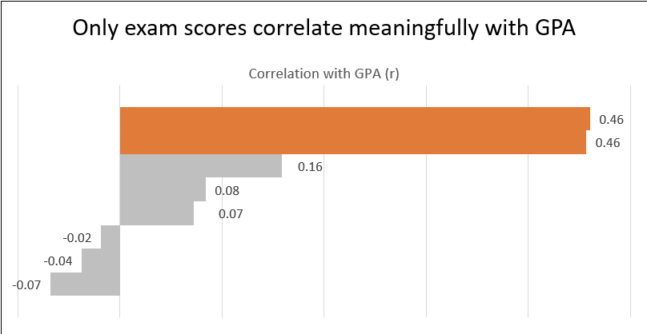
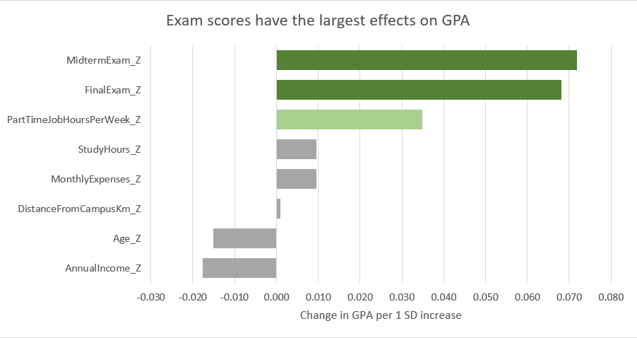
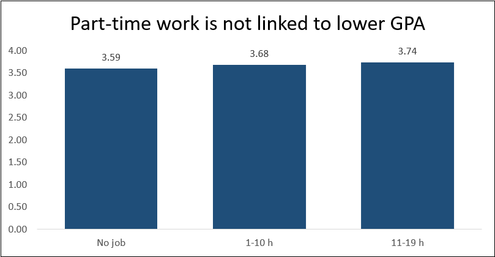
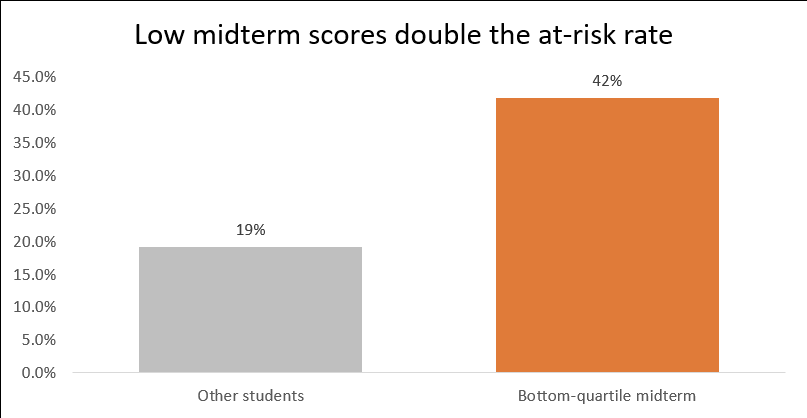
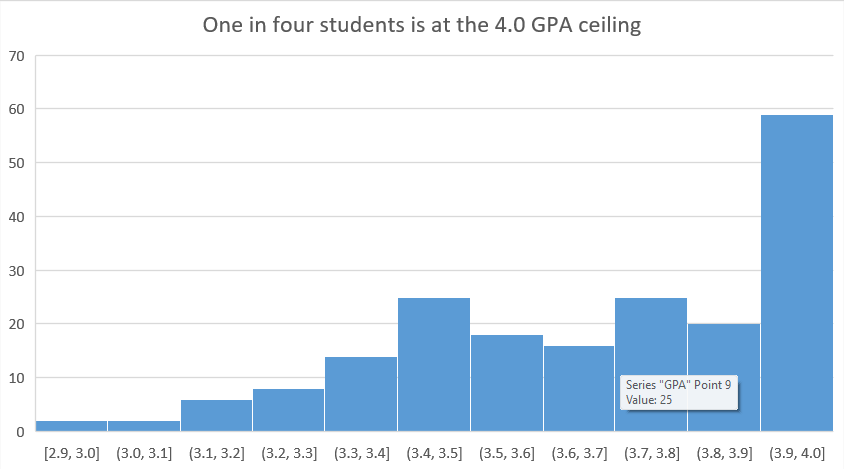
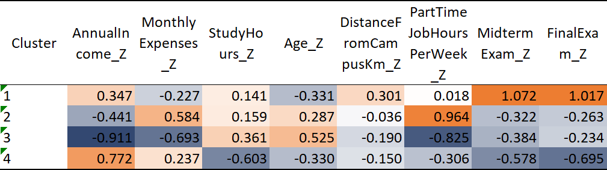

# What Drives Student GPA? Data Cleaning & Statistical Analysis in Excel


**Summary.** I cleaned and analysed records for 200 students in Excel to find
which characteristics are associated with lower GPA. Exam performance is the
only strong signal: six non-academic variables (income, expenses, study hours,
age, commute distance, part-time work) together explain about 4% of GPA
variance. Students in the bottom quarter of midterm scores are 2.2 times as
likely to be at risk (42% vs 19%), which makes the midterm a practical
early-warning indicator.

> Originally built as the capstone of an Excel course; later restructured,
> corrected and extended.

## Business Question

A university student-success office has limited advising capacity and wants
to know where to focus support:

1. Which student characteristics are associated with lower GPA?
2. Is there a simple signal during the semester that identifies students at risk?

## Dataset

- Source: [e.g. "Synthetic dataset provided in an Excel course" or Kaggle link + licence]
- 200 students, 10 columns, one row per student
- Target variable: GPA (0 to 4 scale)

| Column | Type | Unit | Description |
|---|---|---|---|
| StudentID | Text | - | Unique student identifier |
| AnnualIncome | Integer | USD / year | Annual income |
| MonthlyExpenses | Integer | USD / month | Monthly living expenses |
| StudyHours | Decimal | Hours / week | Average weekly study time |
| MidtermExam | Decimal | Score 0-100 | Midterm exam score |
| FinalExam | Decimal | Score 0-100 | Final exam score |
| Age | Integer | Years | Student age |
| GPA | Decimal | 0-4 | Grade point average (target) |
| DistanceFromCampusKm | Decimal | km | Distance from home to campus |
| PartTimeJobHoursPerWeek | Integer | Hours / week | Weekly part-time work |

Derived columns (groups, flags, z-scores, cluster) are documented in the
`02_Data_Dictionary` sheet.

## Tools

- **Microsoft Excel 365:** Tables, XLOOKUP, FILTER, LET, PivotTables, Slicers,
  charts, Analysis ToolPak (t-test, ANOVA, regression)
- **XLSTAT add-in:** Ridge and Lasso regression, k-means clustering
  (results stored as values, so the workbook opens without XLSTAT)

## Data Preparation

| Step | Finding | Action | Reason |
|---|---|---|---|
| Missing values | 5 blanks in each of 9 columns (45 cells in 42 rows; max 2 per row) | Removed the 5 rows with missing GPA; filled the other 38 blanks with the column median | GPA is the target and should not be invented; only 2.5% of each column was missing |
| Outliers | IQR rule flags 11 values in 6 columns | Kept and flagged | Values are plausible and sit on both tails |
| Scaling | Variables on very different scales | z-scores for regression and clustering only | Makes coefficients and distances comparable |
| Grouping | - | Income: median split. Part-time work: 0 h, 1-10 h, 11-19 h. Distance: tertiles | Every group has enough students to compare |
| Flags | - | AtRisk: GPA below 1st quartile (3.51). EarlyWarning: midterm below 1st quartile (63) | Defines the business outcome |

Final analysis dataset: **195 students**.

## Analysis

1. **Exploratory analysis:** descriptive statistics, GPA distribution,
   correlations with GPA
2. **Group comparisons:** Welch t-test (income), one-way ANOVA
   (part-time work, distance)
3. **Regression:** three OLS models (all predictors, exams only,
   non-academic only), checked with Ridge and Lasso (lambda chosen by
   5-fold cross-validation)
4. **Segmentation:** k-means (k = 4, Trace(W), 20 random starts),
   profiled by GPA and at-risk rate

## Key Findings

1. **Exam scores are the only strong correlates of GPA**
   (midterm r = 0.46, final r = 0.46).

   

2. **Non-academic factors add little.** The six non-academic variables explain
   4% of GPA variance (R² = 0.04, p = 0.20). With exam scores, R² is 0.27.
   Ridge and Lasso confirm this: Lasso shrinks five of the six non-academic
   coefficients to zero.

   

3. **No significant GPA differences by income, part-time work or distance**
   (Welch t-test p = 0.22; one-way ANOVA p = 0.18 and p = 0.63).

4. **Working more hours is not linked to lower GPA.** Students working
   11-19 h per week average 3.74, vs 3.68 for 1-10 h.

   

5. **Low midterm scores double the risk.** 42% of students in the bottom
   midterm quartile are at risk, vs 19% of the others.

   

6. **One in four students is at the 4.0 ceiling**, which limits what a linear
   model can explain.

   

7. **Segments differ mainly on exam scores.** At-risk rates range from 7% in
   the high exam performers cluster to 38% in the cluster with the highest
   income, fewer study hours and lower exam scores. Cluster structure is weak
   (silhouette about 0.1), so the segments are broad profiles, not sharply
   separated groups.

   

## Recommendations

1. **Use the midterm as an early-warning trigger.** After midterms, invite
   students scoring below 63/100 to academic advising.
2. **Do not target support by income or part-time work alone.** The data shows
   no evidence that these groups perform worse.
3. **Collect behavioural data** such as attendance and assignment submission;
   the current variables explain only about a quarter of GPA variance.

## Limitations

- Data source is unknown.
- Small sample (195 students) from a single point in time.
- GPA is capped at 4.0 (24% of students), which weakens linear models.
- Observational data: results show associations, not causes.
- The "No job" group has only 8 students.

## Future Improvements

- Validate the early-warning rule on a new semester of data.
- Repeat the analysis in SQL or Python for full reproducibility.

## Repository Structure

```
student-performance-analysis-excel/
├── README.md
├── data/
│   ├── raw/student_data_raw.csv
│   └── processed/student_data_clean.csv
├── excel/student_performance_analysis.xlsx
└── images/
```

## How to Use

Open `excel/student_performance_analysis.xlsx` and start at the `00_Overview`
sheet. Sheets are numbered in the order of the analysis. The cleaned data is
also available as CSV in `data/processed/`.

## Author

[Erfan Atabzadeh] · [www.linkedin.com/in/erfan-atabzadeh-324182351] · [atabzadeh.erfan@gmail.com]
